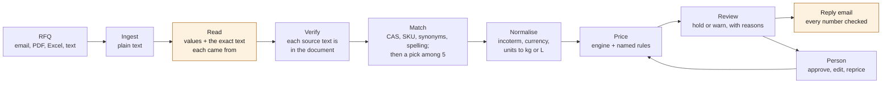

# Quotient

Reads a customer's request for quotation (an email, PDF, spreadsheet or pasted text) and returns a priced
quote draft and a reply email. Every price traces to a price-list row and a named pricing rule. Anything the
system is unsure of is held for a person with the reason, never guessed.

Built in a day as a prototype for a specialty-chemicals trading desk. All data is synthetic.

## Results

30 messy RFQs (14 emails, 6 pasted texts, 5 PDFs, 5 spreadsheets) with gold answers. The gold prices were
computed by the pricing engine from hand-checked readings, not typed. Ten RFQs were held out before any
prompt was written. Prompts were tuned on the 20 dev RFQs only, with gpt-oss-120b, and frozen before any
model saw the holdout. Each model then ran once; the holdout columns are reported as they came out.

**Which models ran.** Everything ran on Groq's free plan: 200K tokens per model per day, 8K per minute.

- **qwen3.8-27b**, instruct mode (no reasoning): one full run, dev and holdout. About 5K tokens per RFQ.
- **gpt-oss-20b**, medium reasoning: the 20 dev RFQs only; its holdout has not been run. A full run with reply
  emails needs about 225K tokens, more than one day allows. 3 of the 20 RFQs failed on Groq's side: twice the
  answer was cut off (8K tokens a minute leaves about 4K for reasoning and answer after the 3.9K prompt), and
  once Groq rejected an answer as off-schema although strict mode is meant to prevent that.
- **gpt-oss-120b**: no scored run. Its day's tokens went on tuning the prompts on the dev RFQs.
- **llama-3.3-70b-versatile**: this account cannot use it (the API returns 404; it is not in the model list).

<!-- evals:start -->

Live models, one run each after the prompts were frozen:

| | qwen3.8-27b, dev (20 RFQs, 55 lines) | qwen3.8-27b, holdout (10 RFQs, 25 lines) | gpt-oss-20b, dev (20 RFQs, 55 lines) | gpt-oss-20b, holdout |
|---|---:|---:|---:|---:|
| Right SKU (lines) | 54/55 (98.2%) | 25/25 (100.0%) | 44/55 (80.0%) | not run |
| Exact unit price and line total (priced gold lines) | 48/48 (100.0%) | 21/21 (100.0%) | 38/48 (79.2%) | not run |
| Exact quote total (RFQs) | 19/20 (95.0%) | 10/10 (100.0%) | 17/20 (85.0%) | not run |
| Flag recall (gold flags caught) | 53/54 (98.1%) | 19/20 (95.0%) | 42/54 (77.8%) | not run |
| Flag precision (raised flags that were right) | 53/53 (100.0%) | 19/19 (100.0%) | 42/42 (100.0%) | not run |
| Lines needing a person that were held | 15/16 (93.8%) | 7/8 (87.5%) | 14/14 (100.0%) | not run |
| Lines sent without a person that were right | 39/40 (97.5%) | 18/18 (100.0%) | 30/30 (100.0%) | not run |
| **Silent errors** (wrong and not held) | **1 of 55 lines** | **0 of 25 lines** | **0 of 55 lines** | not run |
| Time per RFQ, median / p90, excl. rate-limit waits | 2.7 s / 3.4 s | 2.6 s / 3.1 s | 4.0 s / 4.6 s | not run |
| Time per RFQ, median / p90, incl. waits (free tier) | 49.0 s / 60.1 s | 45.3 s / 68.1 s | 48.5 s / 58.5 s | not run |
| Model cost per RFQ, mean | $0.0066 | $0.0064 | $0.0010 | not run |
| Model calls per RFQ, mean | 2.1 | 2.1 | 2.1 | not run |
| RFQs that failed | 0 of 20 | 0 of 10 | 3 of 20 | not run |

`qwen3.8-27b` instruct mode, no reasoning, run `20261011-084624-qwen_qwen3.8-27b.json`, code `43caae2`; `gpt-oss-20b` reasoning effort medium, run `20261011-083759-openai_gpt-oss-20b.json`, dev RFQs only, code `43caae2`.
Cost uses Groq's list prices per million tokens, checked on 2026-10-11: qwen3.8-27b $0.80 input, $4.00 output; gpt-oss-20b $0.075 input, cached input $0.0375, $0.30 output. qwen3.8-27b: Groq has no prompt caching for this model; gpt-oss-20b: 30% of input tokens were cached (half price).

<details><summary>qwen3.8-27b: reading accuracy per field, matching by method, flags by code</summary>

| Field | Dev | Holdout |
|---|---:|---:|
| Line found | 55/55 (100.0%) | 25/25 (100.0%) |
| Quantity as written | 55/55 (100.0%) | 25/25 (100.0%) |
| Unit as written | 55/55 (100.0%) | 25/25 (100.0%) |
| Grade stated | 55/55 (100.0%) | 24/25 (96.0%) |
| CAS number | 8/8 (100.0%) | – |
| Quantity in the SKU's unit | 50/50 (100.0%) | 23/23 (100.0%) |
| Pack | 50/50 (100.0%) | 23/23 (100.0%) |
| Customer | 20/20 (100.0%) | 10/10 (100.0%) |
| Incoterms mentioned | 20/20 (100.0%) | 10/10 (100.0%) |
| Incoterm priced | 20/20 (100.0%) | 10/10 (100.0%) |
| Destination | 20/20 (100.0%) | 10/10 (100.0%) |
| Currency | 20/20 (100.0%) | 10/10 (100.0%) |
| Requested date | 17/20 (85.0%) | 9/10 (90.0%) |

| Matched by | Dev | Holdout |
|---|---:|---:|
| CAS number | 8/8 (100.0%) | – |
| Synonym table | 37/37 (100.0%) | 24/24 (100.0%) |
| Reader's English name | 7/8 (87.5%) | – |
| No match (right when the gold has none) | 2/2 (100.0%) | 1/1 (100.0%) |

| Flag (all 30 RFQs) | In gold | Caught | Missed | Extra |
|---|---:|---:|---:|---:|
| `ambiguous_unit` | 1 | 1 | 0 | 0 |
| `below_moq` | 5 | 5 | 0 | 0 |
| `customer_unknown` | 1 | 1 | 0 | 0 |
| `grade_not_specified` | 4 | 3 | 1 | 0 |
| `hazmat_documents` | 43 | 43 | 0 | 0 |
| `incoterm_conflict` | 2 | 2 | 0 | 0 |
| `incoterm_unsupported` | 2 | 2 | 0 | 0 |
| `margin_floor_applied` | 2 | 2 | 0 | 0 |
| `no_freight_lane` | 2 | 2 | 0 | 0 |
| `no_match` | 4 | 3 | 1 | 0 |
| `price_expired` | 5 | 5 | 0 | 0 |
| `quantity_missing` | 1 | 1 | 0 | 0 |
| `unit_conversion_impossible` | 2 | 2 | 0 | 0 |

Silent errors: rfq-010 line 4 (Cellosolve acetate (EGEEA)).

</details>

<details><summary>gpt-oss-20b: reading accuracy per field, matching by method, flags by code</summary>

| Field | Dev | Holdout |
|---|---:|---:|
| Line found | 44/55 (80.0%) | not run |
| Quantity as written | 43/55 (78.2%) | not run |
| Unit as written | 44/55 (80.0%) | not run |
| Grade stated | 44/55 (80.0%) | not run |
| CAS number | 5/8 (62.5%) | not run |
| Quantity in the SKU's unit | 39/50 (78.0%) | not run |
| Pack | 40/50 (80.0%) | not run |
| Customer | 17/20 (85.0%) | not run |
| Incoterms mentioned | 17/20 (85.0%) | not run |
| Incoterm priced | 17/20 (85.0%) | not run |
| Destination | 17/20 (85.0%) | not run |
| Currency | 17/20 (85.0%) | not run |
| Requested date | 16/20 (80.0%) | not run |

| Matched by | Dev | Holdout |
|---|---:|---:|
| CAS number | 5/5 (100.0%) | not run |
| Synonym table | 34/34 (100.0%) | not run |
| Reader's English name | 3/3 (100.0%) | not run |
| No match (right when the gold has none) | 2/2 (100.0%) | not run |
| Line not found, or the RFQ failed | 0/11 (0.0%) | not run |

| Flag (dev RFQs) | In gold | Caught | Missed | Extra |
|---|---:|---:|---:|---:|
| `below_moq` | 4 | 4 | 0 | 0 |
| `customer_unknown` | 1 | 1 | 0 | 0 |
| `grade_not_specified` | 3 | 2 | 1 | 0 |
| `hazmat_documents` | 32 | 23 | 9 | 0 |
| `incoterm_conflict` | 1 | 1 | 0 | 0 |
| `margin_floor_applied` | 2 | 1 | 1 | 0 |
| `no_freight_lane` | 2 | 2 | 0 | 0 |
| `no_match` | 3 | 2 | 1 | 0 |
| `price_expired` | 4 | 4 | 0 | 0 |
| `quantity_missing` | 1 | 1 | 0 | 0 |
| `unit_conversion_impossible` | 1 | 1 | 0 | 0 |

Silent errors: none.

</details>

**Pipeline test: rules and pricing are correct given correct readings.** A scripted reader that returns the gold reading replaces the model, so only the deterministic stages are measured: matching rules, grades, units, header rules, pricing and flags. On all 30 RFQs: right SKU 80/80 (100.0%), exact price 69/69 (100.0%), flag recall 74/74 (100.0%), flag precision 74/74 (100.0%), 0 silent errors (run `20261011-084726-oracle.json`). This is not a model result; it shows that every miss in the live tables above starts with the model's reading or with matching what it read.

<!-- evals:end -->

The number to watch is **silent errors**: lines that are wrong and were not held for a person. A held line
costs a minute of review; a silent error goes to the customer. An RFQ whose model call failed counts as wrong
on every accuracy row and under "RFQs that failed", but not as silent errors: the desk gets an error and
nothing reaches the customer. The rows about holding lines are measured on RFQs that returned a draft.

### Changes after the prompts were frozen

The prompts were frozen in `3ecca54`. Before any holdout result was seen:

1. `3787219`: a CAS number is used for matching only if it is in the document (on dev RFQ rfq-001,
   gpt-oss-20b recalled PGMEA's CAS for a PGME line, and the line was matched to it). The quantity may come back
   as a JSON number, and qwen3.8-27b gets Groq's strict decoding (qwen wrote `"}, "` as a quantity on rfq-001).
   The prompt text did not change; the output schema did.
2. Scoring: the failed-RFQ and held-line rules in the paragraph above (committed with item 3 in `528f2d0`).
   Before, a failed RFQ's lines counted as silent errors. Every run in the tables is scored with the same rules.

After seeing the qwen holdout numbers:

3. `528f2d0`: the reader's English name must equal a catalog name. qwen read "Cellosolve acetate (EGEEA)" as
   "ethylene glycol ethyl ether acetate", and the name rule matched the "ethylene glycol" inside it to MEG. That
   is the one silent error in the table (dev rfq-010). The tables come from the code before this fix; no run
   was repeated after it, and the demo's saved run still shows the error.

**Matching rules alone, with no model:** given the gold readings, the rules (CAS, SKU code, synonyms, spelling)
match 73 of the 80 gold lines and get none wrong. The other 7 are left for the model's pick among five
candidates ([`tests/test_match.py`](tests/test_match.py)). This is a deterministic result, not a model one.

## How it works



Amber steps use the model (Groq; the deployed app uses `qwen/qwen3.8-27b`). The match step uses it only
for lines the rules could not match. Everything else is plain Python.

## The rule: the model never produces a number

The model reads, chooses among given options and writes prose. It never computes or invents a number.

- **Reading.** Each extracted value comes with the exact text it was read from. Code checks that text is in
  the document, and that a quantity is a number written in it: for "20 x 25L" the model gives 20 and code
  works out 500 L. A week number ("KW 48") is turned into a date by code. An unverified value holds the line.
- **Matching.** Rules first: given the gold readings, they match 73 of 80 lines and get none wrong. For the rest
  the model may only pick one of five candidate SKUs or "none". This is enforced by a JSON-schema
  enum, and the pick is checked again in code. The model also names the substance it reads; a pick that is not
  that substance ("2-ethoxyethyl acetate", then ethyl acetate) is discarded and the line held.
- **Pricing.** Prices, conversions, freight, insurance, FX and rounding are `Decimal` arithmetic in
  [`quotient/pricing/engine.py`](quotient/pricing/engine.py). Every step cites a rule from
  [`rules.yaml`](quotient/pricing/rules.yaml) (versioned; a behaviour change gets a new id) and the data row
  it used.
- **Email.** Every number in the model's draft must occur in the quote data, and every price in the quote must
  appear in the draft. Otherwise the draft is replaced by a template built from the same data, and the reason
  is shown.
- **Export.** The browser holds the draft. The server reprices it before writing the PDF, so a tampered price
  cannot be printed.

When the model and the data disagree, the data wins and the line is flagged.

## Cycle time

The time per RFQ in the table is measured end to end: reading, matching, pricing and the email. It is
reported with and without the waits caused by Groq's free-tier rate limits (8,000 tokens per minute; one
RFQ reads about 5,000). Most of the 45 to 60 s per RFQ is that wait: the model itself works for about 3 s. The hours saved come from the lines
that need no person, shown in the table as lines sent without a person and right. I have not timed people
doing this by hand. That is the first measurement to take on real RFQs, in shadow mode next to the current desk.

## Run it

```bash
uv sync --extra tracing
```

```bash
cp .env.example .env    # add GROQ_API_KEY
```

```bash
uv run uvicorn quotient.api:app --port 8000
```

```bash
cd web && pnpm install && pnpm dev    # http://localhost:3000
```

```bash
uv run pytest    # 145 tests: pricing by hand, every gold RFQ through the pipeline, API, scorer
```

```bash
uv run python evals/run.py --model qwen/qwen3.8-27b --effort none    # or --split dev, --oracle, --combine
```

`--oracle` replaces the model with a scripted reader that returns the gold reading. That is the pipeline test
under the results tables, not a model result.

```bash
uv run python evals/readme.py && uv run python evals/publish.py    # README tables; static demo data for web/
```

**Deploy.** The API runs on Render's free tier ([`render.yaml`](render.yaml)), which sleeps when idle and takes
about 30 s to wake. So the web app (Vercel, root directory `web`) does not need it to open a sample: the 30
RFQs, the catalog, the rules, the eval results and each sample's draft from the published live run are static
files written by `evals/publish.py`. The API is called only to run something live (an upload, pasted text, "Run
live" on a sample) and for edits, PDF export and email redrafts, because repricing stays on the server's
engine. Any call that takes more than 2.5 s shows a "waking the server" note; a failed live run on a sample
offers its saved run. On Render set `GROQ_API_KEY`
(dashboard only, never in the repo) and `QUOTIENT_CORS_ORIGINS` to the web URL; on Vercel set
`NEXT_PUBLIC_API_URL` to the API URL. Optional Langfuse tracing turns on with `LANGFUSE_PUBLIC_KEY` and
`LANGFUSE_SECRET_KEY`.

## Data

Generated with the Misata Studio engine ([`data/generate.py`](data/generate.py)), seeded and reproducible
(file hashes in `data/manifest.json`).

- **Real public facts:** 42 chemicals with their CAS numbers (check digits verified), UN numbers, hazard
  classes, densities and HS codes.
- **Fictional:** companies, trade names, prices, freight and FX.

The data has 73 SKUs, 584 price rows, 72 freight rates (3 origin ports × 6 countries × 4 incoterms) and 30
customers in six countries.

## Assumptions

Simplifications chosen where a chemistry or trade detail was uncertain:

- A 200 L drum or 1000 L IBC holds its nominal volume. Its kg content is volume × density at 20 °C.
- "Tons" means metric tonnes. From a US buyer the line is held, since it may mean short tons.
- An unstated grade is priced at the lowest grade offered, and the line is held.
- CIF insurance is 110% of the CFR value at 0.15%. Dangerous goods pay a flat surcharge per kg on main carriage.
- Freight is per kg, per destination country, to one main port. FOB is origin handling only.
- FX is one dated snapshot (2026-10-01). It is synthetic, not market data.
- A quote is valid 14 days, and never beyond the validity of a price row it uses.
- Two incoterms in one RFQ: the customer's usual one is priced and the quote is held.
- Reasoning tokens are billed as output tokens; Groq's pricing page does not say otherwise.
- Contact names are random and not matched to the company's country.

## Limitations

- **The eval set is mine.** One person wrote the RFQs, the gold and the rules. The holdout limits tuning to
  the test, but it does not remove shared blind spots. Real RFQs will be messier.
- **30 RFQs is small.** One line moves overall accuracy by 1.25 points, and the 25-line holdout by 4.
- **No OCR.** A scanned PDF without a text layer is rejected with a clear message.
- **Freight is country-level.** There are no container, LCL or truck rates. FCL, pallet and truckload
  quantities are held, not converted. FCA, CPT, CIP and DDP are not priced; they are held.
- **One quote, one currency.** FX is a snapshot, not a live feed.
- **No storage, no accounts.** Drafts live in the browser tab. The API caps live runs per IP per hour.
- **Free-tier model limits.** 200K tokens per model per day is about 40 live runs on qwen3.8-27b. After that,
  live runs fail until the window frees up; saved runs still open.
- **Cost counts answered calls.** Groq returns no token usage for an answer it rejects, so a rejected attempt
  (3 RFQs in the gpt-oss-20b run) is not in the cost per RFQ.

## What to build next for this business

1. **Export documents for six countries.** From an approved quote, draft the commercial invoice, packing list,
   certificate of origin and dangerous-goods declaration for the US, Germany, the Netherlands, the UAE, Japan
   and Brazil. The HS codes, UN numbers, hazard classes and pack counts are already on every line. Each
   country's requirements would be named, versioned rules like the pricing rules, and the model would only
   fill in prose.
2. **A supplier RFQ agent.** When a line has no match, no current price or falls below the margin floor, draft
   RFQs to approved suppliers, read their replies with the same verified reader, and feed the cost into
   pricing. This turns a held line into a priced one.
3. **CoA checks.** Read suppliers' certificates of analysis and compare each parameter (purity, water, heavy
   metals) with the grade specification. Hold out-of-spec batches before they ship, citing the CoA line
   and the spec it fails.

Before any of these: run the reader in shadow mode on a few weeks of real RFQs, time the desk, and grow
the eval set from the misses.

## Layout

```
quotient/pricing/   engine, rules.yaml, units          the deterministic core
quotient/pipeline/  ingest, extract, match, normalise, output, run
quotient/api.py     FastAPI: quotes, reprice, email, PDF, samples, evals
data/               generator, CSVs, manifest
evals/              specs, rendered RFQs, gold, runner, results
web/                Next.js: intake, review screen, evals page
tests/              pricing by hand, units, grades, pipeline, API, scorer
```
