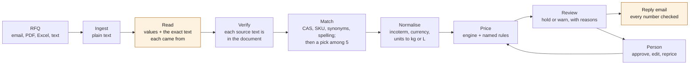

# Quotient

Reads a customer's request for quotation (an email, PDF, spreadsheet or pasted text) and returns a priced
quote draft and a reply email. Every price traces to a price-list row and a named pricing rule. Anything the
system is unsure of is held for a person with the reason, never guessed.

Built in a day as a prototype for a specialty-chemicals trading desk. All data is synthetic.

## Results

30 messy RFQs (14 emails, 6 pasted texts, 5 PDFs, 5 spreadsheets) with gold answers. The gold prices were
computed by the pricing engine from hand-checked readings, not typed. Ten RFQs were held out before any
prompt was written and were never used to tune one.

<!-- evals:start -->
Pending the first live run (`uv run python evals/run.py`, then `uv run python evals/readme.py`).
<!-- evals:end -->

The number to watch is **silent errors**: lines that are wrong and were not held for a person. A held line
costs a minute of review; a silent error goes to the customer.

## How it works



Amber steps use the model (Groq, `openai/gpt-oss-120b`). The match step uses it only for lines the rules
could not match. Everything else is plain Python.

## The rule: the model never produces a number

The model reads, chooses among given options and writes prose. It never computes or invents a number.

- **Reading.** Each extracted value comes with the exact text it was read from. Code checks that text is in
  the document, and that a quantity is one of the numbers in it. An unverified value holds the line.
- **Matching.** The model may only pick one of five candidate SKUs or "none". This is enforced by a JSON-schema
  enum, and the pick is checked again in code.
- **Pricing.** Prices, conversions, freight, insurance, FX and rounding are `Decimal` arithmetic in
  [`quotient/pricing/engine.py`](quotient/pricing/engine.py). Every step cites a rule from
  [`rules.yaml`](quotient/pricing/rules.yaml) (versioned; a behaviour change gets a new id) and the data row
  it used.
- **Email.** Every number in the model's draft must occur in the quote data, and every price in the quote must
  appear in the draft. Otherwise the draft is replaced by a template built from the same data, and the reason
  is shown.
- **Export.** The browser holds the draft. The server reprices it before writing the PDF, so a tampered price
  cannot be printed.

When the model and the data disagree, the data wins and the line is flagged.

## Cycle time

The time per RFQ in the table is measured end to end: reading, matching, pricing and the email. It is
reported with and without the waits caused by Groq's free-tier rate limits. The hours saved come from the lines
that need no person, shown in the table as lines sent without a person and right. I have not timed people
doing this by hand. That is the first measurement to take on real RFQs, in shadow mode next to the current desk.

## Run it

```bash
uv sync --extra tracing
```

```bash
cp .env.example .env    # add GROQ_API_KEY
```

```bash
uv run uvicorn quotient.api:app --port 8000
```

```bash
cd web && pnpm install && pnpm dev    # http://localhost:3000
```

```bash
uv run pytest    # 129 tests: pricing by hand, every gold RFQ through the pipeline, API, scorer
```

```bash
uv run python evals/run.py    # add --split holdout, --model openai/gpt-oss-20b, or --oracle
```

`--oracle` replaces the model with a scripted reader that returns the gold reading. It scores 100% on every
metric, which shows the deterministic stages are right; what the live run loses is reading and matching.

**Deploy.** The API runs on Render ([`render.yaml`](render.yaml)). Set `GROQ_API_KEY` and set
`QUOTIENT_CORS_ORIGINS` to the web URL. The web app runs on Vercel with root directory `web` and
`NEXT_PUBLIC_API_URL` pointing at the API. Each sample opens instantly from the last live eval run; uploads and
pastes always run live. Optional Langfuse tracing turns on with `LANGFUSE_PUBLIC_KEY` and `LANGFUSE_SECRET_KEY`.

## Data

Generated with the Misata Studio engine ([`data/generate.py`](data/generate.py)), seeded and reproducible
(file hashes in `data/manifest.json`).

- **Real public facts:** 42 chemicals with their CAS numbers (check digits verified), UN numbers, hazard
  classes, densities and HS codes.
- **Fictional:** companies, trade names, prices, freight and FX.

The data has 73 SKUs, 584 price rows, 72 freight rates (3 origin ports × 6 countries × 4 incoterms) and 30
customers in six countries.

## Assumptions

Simplifications chosen where a chemistry or trade detail was uncertain:

- A 200 L drum or 1000 L IBC holds its nominal volume. Its kg content is volume × density at 20 °C.
- "Tons" means metric tonnes. From a US buyer the line is held, since it may mean short tons.
- An unstated grade is priced at the lowest grade offered, and the line is held.
- CIF insurance is 110% of the CFR value at 0.15%. Dangerous goods pay a flat surcharge per kg on main carriage.
- Freight is per kg, per destination country, to one main port. FOB is origin handling only.
- FX is one dated snapshot (2026-10-01). It is synthetic, not market data.
- A quote is valid 14 days, and never beyond the validity of a price row it uses.
- Two incoterms in one RFQ: the customer's usual one is priced and the quote is held.
- Reasoning tokens are billed as output tokens; Groq's pricing page does not say otherwise.
- Contact names are random and not matched to the company's country.

## Limitations

- **The eval set is mine.** One person wrote the RFQs, the gold and the rules. The holdout limits tuning to
  the test, but it does not remove shared blind spots. Real RFQs will be messier.
- **30 RFQs is small.** One line moves overall accuracy by 1.25 points, and the 25-line holdout by 4.
- **No OCR.** A scanned PDF without a text layer is rejected with a clear message.
- **Freight is country-level.** There are no container, LCL or truck rates. FCL, pallet and truckload
  quantities are held, not converted. FCA, CPT, CIP and DDP are not priced; they are held.
- **One quote, one currency.** FX is a snapshot, not a live feed.
- **No storage, no accounts.** Drafts live in the browser tab. The API caps live runs per IP per hour.

## What to build next for this business

1. **Export documents for six countries.** From an approved quote, draft the commercial invoice, packing list,
   certificate of origin and dangerous-goods declaration for the US, Germany, the Netherlands, the UAE, Japan
   and Brazil. The HS codes, UN numbers, hazard classes and pack counts are already on every line. Each
   country's requirements would be named, versioned rules like the pricing rules, and the model would only
   fill in prose.
2. **A supplier RFQ agent.** When a line has no match, no current price or falls below the margin floor, draft
   RFQs to approved suppliers, read their replies with the same verified reader, and feed the cost into
   pricing. This turns a held line into a priced one.
3. **CoA checks.** Read suppliers' certificates of analysis and compare each parameter (purity, water, heavy
   metals) with the grade specification. Hold out-of-spec batches before they ship, citing the CoA line
   and the spec it fails.

Before any of these: run the reader in shadow mode on a few weeks of real RFQs, time the desk, and grow
the eval set from the misses.

## Layout

```
quotient/pricing/   engine, rules.yaml, units          the deterministic core
quotient/pipeline/  ingest, extract, match, normalise, output, run
quotient/api.py     FastAPI: quotes, reprice, email, PDF, samples, evals
data/               generator, CSVs, manifest
evals/              specs, rendered RFQs, gold, runner, results
web/                Next.js: intake, review screen, evals page
tests/              pricing by hand, units, grades, pipeline, API, scorer
```
